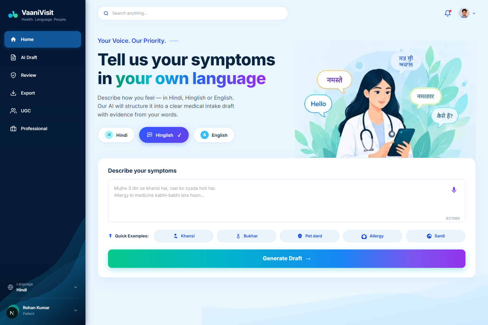
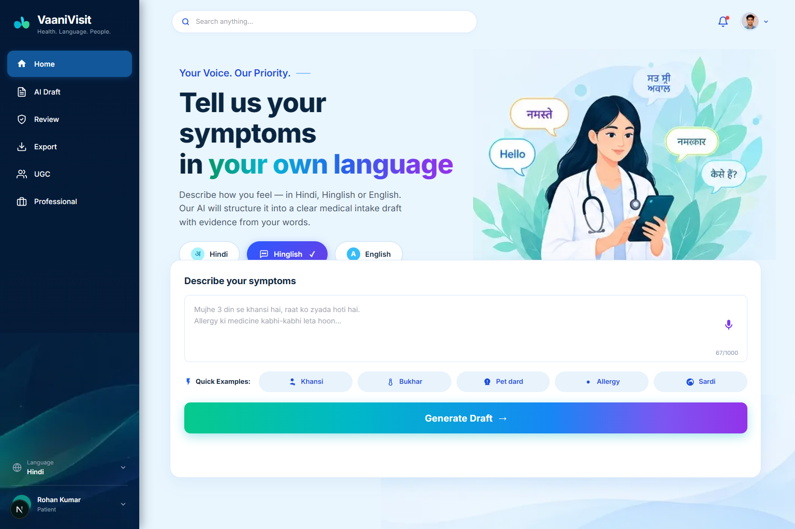
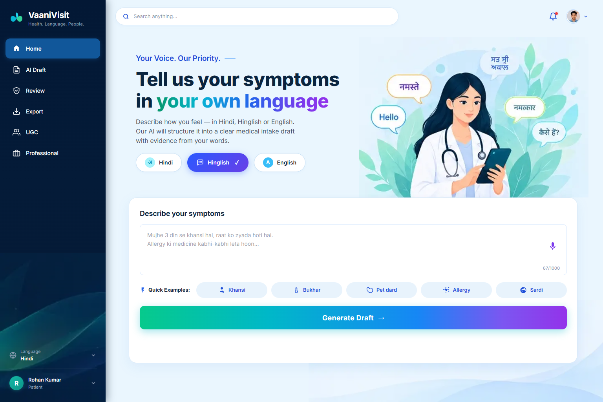
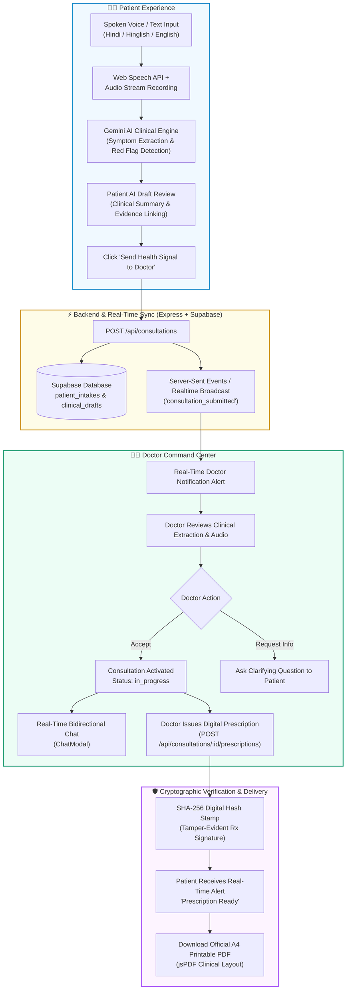

<div align="center">

# 🩺 Vaani Vision (वाणी विज़न)
### AI-Powered Multilingual Patient–Doctor Teleconsultation & Clinical Intake System
*Evidence-Backed Multilingual Healthcare • हर आवाज़ मायने रखती है (Every Voice Matters)*

[](https://react.dev/)
[](https://vitejs.dev/)
[](https://www.typescriptlang.org/)
[](https://ai.google.dev/)
[](https://supabase.com/)
[](https://expressjs.com/)
[](LICENSE)

<br/>


</div>

---

## 🌟 Executive Overview

**Vaani Vision** is a healthcare platform bridging the communication gap between patients and medical professionals across linguistic barriers. In regions where millions speak mixed vernaculars like **Hindi, Hinglish, and regional Indian dialects**, explaining complex medical symptoms to busy doctors is daunting.

Vaani Vision allows patients to simply **speak or type their symptoms naturally in their mother tongue**. Our integrated **Google Gemini AI** engine transcribes the audio, performs clinical fact extraction, flags emergency red flags, and summarizes the complaint into an actionable clinical draft. 

Once approved by the patient, the health signal is delivered in **real-time** to the assigned physician's dashboard (e.g. **Dr. Priya Sharma**), where the doctor can review the AI clinical extraction, accept the consultation, interact over secure live chat, and issue a **cryptographically verified digital prescription (SHA-256)** downloadable as an official A4 PDF.

---

## 📸 Visual Showcase

<div align="center">

### 1. Multilingual Symptom Voice Studio & AI Clinical Intake
Patients can describe symptoms in Hindi, Hinglish, or English with live waveform audio capture.


---

### 2. Patient Command Center & Real-Time Tracking
Patients track consultations, pending reviews, doctor notes, and quick health signals.


---

### 3. Doctor Review Dashboard & Clinical Queue
Physicians receive live incoming patient requests, clinical urgency ratings, and draft approvals.


---

### 4. Patient & Doctor Portals with Role-Based Authentication
Independent login pathways for patients and medical practitioners with Supabase Auth.


</div>

---

## 🏗️ End-to-End System Architecture



---

## ✨ Core Features

### 🎙️ Multilingual Voice & Text Intake
- **Languages Supported**: Hindi, Hinglish (mixed colloquial Hindi-English), and standard English.
- **Audio Capture**: Browser `SpeechRecognition` and `MediaStream` with live animated waveform feedback.
- **Intelligent Pre-processing**: Handles hesitation, colloquial terms (e.g., *"seene me dawab"*, *"pet kharab"*, *"khansi raat me zyada"*).

### 🤖 Gemini AI Clinical Structuring & Red Flag Engine
- **Main Complaint Extraction**: Identifies the primary ailment and related secondary symptoms.
- **Temporal & Pattern Analysis**: Extracts duration (e.g. *"3 days"*), trigger factors, and progression patterns.
- **Evidence Quote Verification**: Maps each extracted medical entity back to the exact substring in the patient's statement, preventing AI hallucinations.
- **Emergency Red Flag Detection**: Instantly tags cardiac distress (*"chest pain"*, *"saans lene me takleef"*), acute bleeding, or syncope as **🚨 Urgent**.

### 👨‍⚕️ Strict Doctor & Patient Role Separation
- **Independent Interfaces**: Doctors and patients operate in dedicated dashboard environments.
- **Unified Navigation**: Zero duplicate sidebars or nested layout bugs. Direct URL routing (`/patient/prescriptions`, `/doctor`, `/review`) works seamlessly across back/forward navigation and page refresh.
- **Route Guarding**: Role-aware protected routes backed by Supabase profile roles (`patient`, `reviewer`, `doctor`).

### 📄 Cryptographically Verified Digital Prescriptions
- **SHA-256 Integrity Seal**: Every prescription generates a unique cryptographic hash verifying the doctor's registration, date, and medicines.
- **Vector PDF Output**: Generates clean, hospital-grade A4 printable PDF documents using `jsPDF` with clinic letterheads, dosage schedules, precautions, and verified doctor digital signatures.

### 💬 Real-Time Bidirectional Messaging
- Instant communication modal (`ChatModal`) connecting active patients to their assigned physician.
- Live notifications for incoming questions, accepted consultations, and issued prescriptions.

---

## 🛠️ Technology Stack

| Layer | Technologies |
|---|---|
| **Frontend Framework** | React 19, Vite 8, TypeScript 5.5, React Router 7 |
| **Styling & Design** | Custom Design System, Modern Inter Typography, Glassmorphism, Responsive CSS3 |
| **Backend API** | Node.js (ES Modules), Express.js (Port 3001) |
| **AI & NLP** | Google Gemini 2.5 Flash / 3.5 Flash Lite via `@google/genai` |
| **Database & Auth** | Supabase PostgreSQL, Row Level Security (RLS), Supabase Auth |
| **PDF Generation** | `jsPDF`, `html2canvas` |
| **Realtime Engine** | Server-Sent Events (SSE) & Supabase Realtime Channels |

---

## 🚀 Quick Start & Installation

### 1. Clone the Repository
```bash
git clone https://github.com/anubhavt675-gif/vaanivist.git
cd vaanivist
```

### 2. Install Dependencies
```bash
# Install workspace dependencies
npm install

# Install frontend application dependencies
cd vaanivisit
npm install
cd ..
```

### 3. Configure Environment Variables
Create or verify `.env` (and `.env.local` inside `vaanivisit/`):

```env
# Supabase Configuration
VITE_SUPABASE_URL=https://wlwlbzrfazwtvsboljzp.supabase.co
VITE_SUPABASE_PUBLISHABLE_KEY=sb_publishable_IqnTtw8qtmdUHCJHFm2ZbA_hu8qRlXF
NEXT_PUBLIC_SUPABASE_URL=https://wlwlbzrfazwtvsboljzp.supabase.co
NEXT_PUBLIC_SUPABASE_PUBLISHABLE_KEY=sb_publishable_IqnTtw8qtmdUHCJHFm2ZbA_hu8qRlXF
SUPABASE_SECRET_KEY=sb_secret_Kx6UFZ1noCM15ElDOP-dmA_DfsK95Lw

# Google Gemini AI Configuration
GEMINI_API_KEY=AQ.Ab8RN6KWm4aWaLCx8wxPmqafLkiulRrjcpNEB2KdOIMKQKuGcw
GEMINI_MODEL=gemini-3.5-flash-lite

# Server Configuration
PORT=3001
NODE_ENV=production
```

### 4. Build and Launch Application
```bash
# Build the production bundle
npm run build

# Start the full-stack server (serves API & production SPA)
npm run server
```

The application will be live at: **http://localhost:3001**

---

## 📡 API Reference

| Method | Endpoint | Description |
|---|---|---|
| `POST` | `/api/consultations` | Submit voice/text health symptoms, triggers Gemini AI clinical extraction, and alerts doctor |
| `GET` | `/api/consultations` | List consultations filtered by `role`, `status`, `q`, and `patient_id` |
| `GET` | `/api/consultations/:id` | Fetch specific consultation intake details and linked prescription |
| `POST` | `/api/consultations/:id/accept` | Doctor accepts consultation request atomically; sets status to `in_progress` |
| `POST` | `/api/consultations/:id/notes` | Doctor appends clinical assessment notes or asks patient follow-up questions |
| `POST` | `/api/consultations/:id/prescriptions` | Generate digital prescription with medicines list and SHA-256 verification hash |
| `GET` | `/api/prescriptions` | Retrieve verified digital prescriptions for patient |
| `GET` | `/api/doctor/overview` | KPI overview metrics (Pending requests, active reviews, urgent alerts) |
| `GET` | `/api/messages` | Fetch real-time chat history between patient and doctor |
| `POST` | `/api/messages` | Send message in consultation chat thread |
| `GET` | `/api/notifications` | Fetch user notifications with read status |
| `POST` | `/api/notifications/mark-read` | Mark notifications as read |

---

## 📁 Repository Directory Structure

```text
vaanivist/
├── docs/
│   └── images/                    # UI screenshots & showcase visuals
│       ├── screenshot.png         # Patient Dashboard Overview
│       ├── screenshot2.png        # Doctor Command Center
│       ├── screenshot3.png        # Multilingual Voice Studio
│       ├── screenshot4.png        # Authentication Portal
│       └── doctor-hero.png        # Medical illustrations
├── vaanivisit/                    # Core Application
│   ├── public/                    # Static assets, branding, logos, wave artwork
│   ├── server/
│   │   └── index.mjs              # Express API Server, Gemini AI & Supabase integration
│   ├── src/
│   │   ├── components/            # Sidebar, ChatModal, VoiceConsultationModal, TopHeader
│   │   ├── lib/                   # Supabase client, PDF generator, Realtime, Role management
│   │   ├── pages/                 # PatientDashboardPage, DoctorDashboardPage, AIDraftPage,
│   │   │                          # HomePage, LoginPage, SignupPage, ExportPage
│   │   ├── App.tsx                # Role-guarded route hierarchy & tabs
│   │   └── main.tsx               # Client entry point
│   ├── package.json
│   ├── vite.config.ts
│   └── .env.local
├── .env                           # Environment keys and deployment configuration
├── .gitignore                     # Optimized gitignore protecting dependencies
├── package.json                   # Workspace root script runner
└── README.md                      # Project documentation and showcase
```

---

## 🔒 Security & Clinical Safety

- **Evidence Anchoring**: Gemini AI extractions are strictly cross-verified against patient spoken input (`exact_quote` verification). Fabricated symptoms are rejected automatically.
- **Cryptographic Seals**: Prescriptions feature a SHA-256 hash stamp containing patient, doctor, and medicine attributes to eliminate prescription tampering.
- **Role Isolation**: Authentication uses Supabase RLS and token verification to ensure patients cannot access doctor review queues or unauthorized clinical records.

---

## 👥 Contributors & Acknowledgements

Developed with ❤️ for **Vaani Vision (वाणी विज़न)** — *Empowering every voice with accessible, AI-powered healthcare.*
